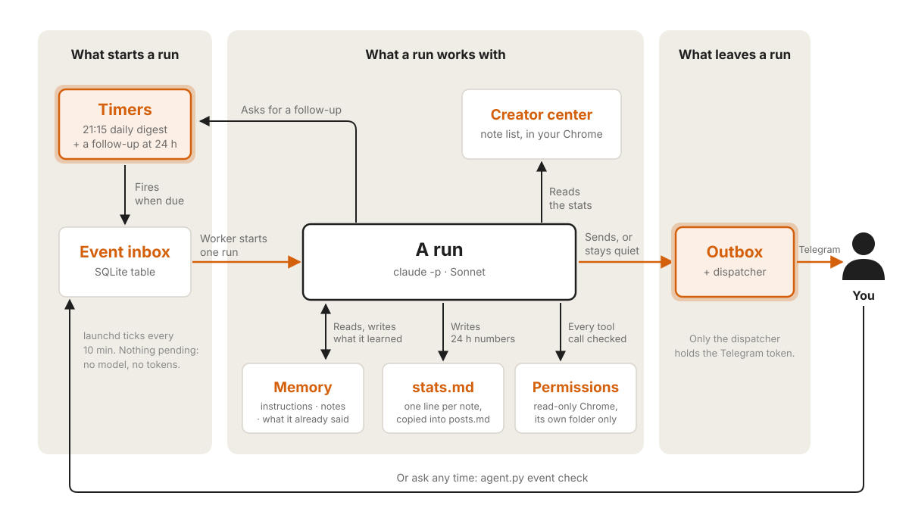
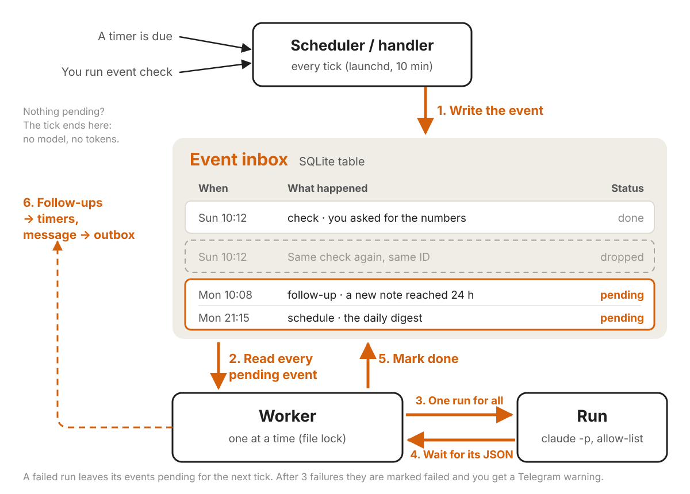
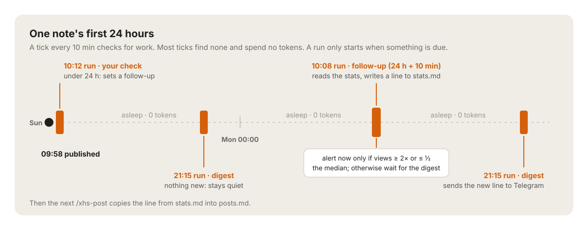

# Plan: an always-on stats agent

Built on 2026-11-15 from Anthropic's article [Building always-on agents](https://claude.com/resources/articles/building-always-on-agents) (William Hu, 2026-11-13).

## Goal
Track how each Xiaohongshu note does in its first 24 hours without me opening the creator center:
- read each note's views, likes, saves and comments once it has been live for 24 hours;
- keep a record that `/xhs-post` copies into `x-assistant/posts.md` (the `24h:` lines the posting-slot test in `x-assistant/xhs-schedule.md` needs);
- message me on Telegram only when it's worth it.

## Design: the article's five parts

| Part | Article | This agent |
|---|---|---|
| Run cycle | An event arrives, a session starts, the agent loop runs, it writes back, it sleeps | `tick` every 10 min (launchd). With nothing due it starts no model, so sleep costs nothing |
| Event inbox | Durable table, a handler that only writes rows, one worker per inbox, dedupe by id, batch events | SQLite `inbox`. `event <kind>` is the handler. The worker takes a file lock and puts every pending event into one run. Ids are unique, so a repeated event is ignored |
| Timers | Follow-ups and schedules, in their own store. A scheduler turns due timers into inbox events | SQLite `timers`: a daily digest at 21:15 (schedule), and one follow-up per note at publish + 24 h + 10 min, which the run itself asks for |
| Memory | A directory of files, loaded lean each run. Store only what can't be looked up again | `memory/instructions.md` (rules, loaded every run), `memory/notes.md` (patterns it noticed), `memory/reported.md` (messages already sent, written by the dispatcher), `stats.md` (the record) |
| Permissions | The riskiest part: a run holds your access and nobody watches. Credentials stay outside, through a proxy | `claude -p` with an allow-list: 5 read-only Chrome tools and read/edit inside its own folder. Bash, clicks, JavaScript, uploads and web fetches are denied. The Telegram token is read only by the dispatcher and never enters the prompt |
| Outbox | A run ends by sending, staying quiet, or asking. Start quiet and earn attention | The run returns JSON `{message, follow_ups, summary}`. A message goes into the SQLite `outbox`, and the dispatcher sends it. The daily digest is sent only when something is new, and a follow-up only when a note is unusual (≥2× or ≤0.5× the median) |

## Architecture

Diagrams in the style of the article's own figures.



Everything here lives in `~/Library/Application Support/stats-agent/` except Chrome, Telegram and `posts.md`. `agent.py tick` runs three plain Python steps: the scheduler, the worker and the dispatcher. Only the worker ever starts a model, and only when the inbox has work. The run can't see the Telegram token, the repo or the rest of the Mac.

What lives where:

| Place | Holds | Written by |
|---|---|---|
| `state/agent.db` → `inbox` | events waiting for a run (`check`, `schedule`, `follow_up`) | the handler and the scheduler; the worker marks them done |
| `state/agent.db` → `timers` | the 21:15 schedule and each note's follow-up time | `db()` creates the schedule; the worker adds the follow-ups a run asks for |
| `state/agent.db` → `outbox` | messages and whether they were sent | the worker (or a failure warning); the dispatcher marks them sent |
| `state/agent.db` → `runs` | each run's time, events, status, cost and one-line summary | the worker |
| `memory/instructions.md` | the rules, loaded into every run | `install` copies it from the repo |
| `memory/notes.md` | patterns the agent noticed | the run |
| `memory/reported.md` | every message already sent, so it doesn't repeat itself | the dispatcher |
| `stats.md` | one line per note with its 24 h numbers | the run |

## Workflow

### One tick


### One note's first 24 hours


## Failure handling
- If a run fails, its events stay pending and are retried on the next tick. After 3 failures they are marked failed and I get a Telegram warning (usually Chrome is closed or the extension is disconnected).
- If the creator center shows a login page, the agent changes nothing and says so.
- If the Mac was asleep, due timers fire on the next tick, and late readings are labelled `late, read at Nh`.

## Decisions along the way
1. **Model:** Sonnet. One run reads one page and writes a line, about US$0.20–0.35 per run.
2. **Where it runs:** this Mac (launchd), because it needs my Chrome sign-in to the creator center. A cloud routine can't use that sign-in.
3. **Out of `~/Documents`:** the first version ran from the repo, but macOS blocks background jobs from `~/Documents`. Full Disk Access for Python would have fixed that, but it gives every Python script access to every file. So the agent now runs from `~/Library/Application Support/stats-agent/`, which macOS doesn't guard, and writes `stats.md` there instead of editing `posts.md`. `/xhs-post` copies the lines across. The background job sees only its own folder.
4. **Telegram:** it sends with the Bot API directly and never loads the Telegram plugin (`enabledPlugins` off), because a second poller would take the bot away from the live Telegram session.

## Files
- `agent.py`: scheduler, worker, dispatcher, handler, `status`, `install`/`uninstall` (one file, standard library only).
- `memory/instructions.md`: the agent's rules, copied into the runtime folder by `install`.
- Runtime folder (not in git): `state/agent.db`, `state/launchd.log`, `memory/notes.md`, `memory/reported.md`, `stats.md`.

## Use
```
python3 -I agents/stats-agent/agent.py install     # copy to ~/Library/Application Support/stats-agent and start the 10-min job
python3 -I agents/stats-agent/agent.py event check # ask for the numbers now
python3 -I agents/stats-agent/agent.py status      # inbox, timers, outbox, recent runs
python3 -I agents/stats-agent/agent.py uninstall   # stop and remove the job
```
Needs: macOS, Python 3, the Claude Code CLI signed in, Chrome open with Claude in Chrome connected and signed in to the creator center, and the Telegram plugin configured once (`~/.claude/channels/telegram/`). After editing `agent.py` or `instructions.md`, run `install` again.

## Not built yet (ideas)
- Read the comment count at the 1- and 2-hour marks to remind me to reply (the article's follow-up timers again).
- Use the run's saved session for a reply in a thread, instead of starting fresh every time.
